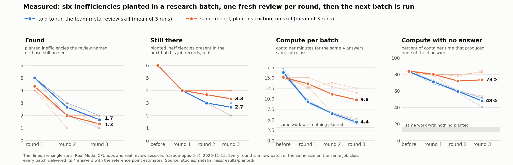

# metaharness: how much the meta-review layer improves the research

Measures whether the `team-meta-review` skill, `tools/cycle.py` and the `meta/<name>.md` entries make the swarm answer
questions faster and with less waste. Plans: `specs/SPEC1.md` (Parts A, B, D) and `specs/SPEC2.md` (the planted-waste test,
which replaces Part C). Parts A and B and the planted-waste test have run; Part D has not.

## Files

| Path | What it is |
|---|---|
| `specs/SPEC1.md` | The plan: metrics M1 to M7, Parts A to D, threats, closest published work. |
| `data/interventions_v1.json` | The five meta-review entries of 2026-11-14: slowest stage, change, made or not. |
| `analysis/scorecard.py` | Part A. Stage minutes per work item with GPU jobs, from the board table, events and job records. |
| `jobs/shard_cell.py` | Shard k of N of an rlneurons cell through the unchanged `run_cell.py` (the change the 21:21 entry named). |
| `analysis/replay.py` | Part B readout: minutes, counts and row comparison per arm, from the jobs' own records. |
| `analysis/replay_extra.py` | Part B: the record of a job cancelled in the queue, and the paired v3 scores of two arms. |
| `specs/SPEC2.md` | Planted-waste test, written before any review run: the six plants, the arenas, the two arms, the measures, hypotheses H1 to H4 with what refutes each. |
| `prep/arena_template/` | The arena study `gapmap` (a CPU research problem on the stored MATH-500 per-problem rows): `planted/` with the six plants, `clean/` the overlay without them. |
| `lib/arena.py`, `prep/build.py` | One arena: a private copy of the repository with its own board (local DynamoDB and S3), its own Modal environment and its own git remote. |
| `prep/worker.py` | The scripted worker: runs one batch the way the arena's files say, posts, comments, commits. |
| `prep/review.py` | One review run: a fresh headless Claude Code session in the arena with the arm's one-sentence prompt. |
| `prep/run_arena.py` | One arena from window 0 to the last window, with the instrument check before the first review. |
| `grader/answer_key_v1.json`, `grader/rubric_v2.md` | The six plants with where each is and when it counts as present; the scoring rules. Both fixed before the runs. |
| `grader/score_window.py` | Scores one window from Modal's job records: container minutes by line, plants present, answers against the reference. |
| `grader/judge_pack.py`, `grader/judge_merge.py` | Packs each review under a neutral name for the judge; checks every quote and files `rubric.json`. |
| `analysis/planted_collect.py`, `analysis/planted_readout.py` | Copies each arena's records into `results/`; writes the summary table and the chart. |
| `data/gapmap_overall_v1/`, `data/gapmap_reference_v1.json`, `data/planted_arenas_v1.json` | The stored overall result planted as P4; the reference tables of the 16 required cells (clean pilot); which arena is which run. |

Run, from the repository root (the replay scripts need `uv run tools/gpu.py get <job>` for each job first):

```
uv run --with boto3 --with modal python -m studies.metaharness.analysis.scorecard
uv run --with modal --with boto3 python -m studies.metaharness.analysis.replay --arm whole_h200=<job> --arm shard4_h100=<4 jobs> --reference whole_h200 --committed whole_h100=studies/rlneurons/results/day1/hard328_base_cue_t10-01/metrics.json
uv run --with modal --with boto3 python -m studies.metaharness.analysis.replay_extra --cancelled whole_b200=<job> --paired shard4_h100=<4 jobs> whole_h200=<job>
```

Raw answers are in sameraslan's Modal Volume `iterate-runs` under the job ids in each `run.json`.

## Numbers

### Planted-waste test (`specs/SPEC2.md`; `results/planted/summary-01/`: `table.md`, `metrics.json`, `chart.png`)

With six known inefficiencies planted in a research batch, three rounds of `team-meta-review` cut the compute per
batch from 16.3 to 4.4 container minutes (3.7 times less) at the same job class and with the same answers; the same
model with a plain instruction reached 9.8. Read 2026-11-15, 04:40 UTC. 3 runs per arm, 9 review runs per arm, model
`claude-opus-5-5`, real Modal CPU jobs (4 cores, at most 8 at a time), every round a new batch of the same 4 required
cells.



Page on the team site: `tools/proof_review_cuts_waste.py`, served at `/proof/review-cuts-waste` with a tile on the tab
Proof, `/proof` (two glass columns, review skill against plain instruction, a switch through the rounds). Every number on it
is copied from `results/planted/summary-01/metrics.json`.

| | before | after round 1 | after round 2 | after round 3 |
|---|---|---|---|---|
| skill: container minutes per batch, mean (runs) | 16.3 (15.6/17.2/16.1) | 9.3 (9.8/9.0/9.0) | 6.5 (6.2/6.7/6.5) | 4.4 (4.0/4.8/4.5) |
| plain: container minutes per batch, mean (runs) | 15.1 (15.1/15.5/14.8) | 13.6 (15.1/12.6/13.1) | 11.1 (12.9/13.8/6.6) | 9.8 (11.5/12.6/5.2) |
| skill: container time with no answer | 83% (83/84/83) | 71% (72/69/73) | 60% (58/60/61) | 48% (41/51/52) |
| plain: container time with no answer | 84% (85/85/82) | 80% (81/80/79) | 72% (78/80/59) | 73% (84/82/54) |
| skill: plants still present, of 6 | 6/6/6 | 4/4/4 | 3/3/3 | 2/3/3 |
| plain: plants still present, of 6 | 6/6/6 | 4/4/4 | 4/4/3 | 4/4/2 |
| skill: minutes from claim to closed work item | 9.9 | 6.1 | 3.3 | 2.4 |
| plain: minutes from claim to closed work item | 9.5 | 6.3 | 3.8 | 3.5 |

The same work with nothing planted costs 3.0 to 3.3 container minutes per batch, 10 to 16% of it with no answer
(4 clean windows, `results/clean/*/metrics.json`, window 0).

Per review run (`results/planted/<arm>-<nn>/review<k>/rubric.json`, `metrics.json`):

| | skill | plain |
|---|---|---|
| plants named, of those present, all 9 reviews | 28 of 39 | 23 of 41 |
| plants named per review, mean | 3.1 | 2.6 |
| plants named in round 1, per run | 5/5/5 of 6 | 4/5/4 of 6 |
| plants removed in the next window, all 9 reviews | 10 | 8 |
| removed plants that came back later | 0 | 0 |
| review session: minutes, USD, turns (mean) | 5.5, 0.69, 20 | 2.3, 0.46, 13 |
| container minutes the review itself spent (mean) | 2.2 | 0.7 |

What each arm removed, from the job records:
- Skill, all 3 runs alike: round 1 the same-seed rerun and the stale README path (P3, P6), round 2 the fix loop (P2),
  round 3 the per-job install (P1), fully in one run and cut from 22 s to 7 s per job in the other two (still counted
  as present). Every skill review measured before and after with its own jobs.
- Plain, all 3 runs: round 1 the fix loop and the stale path (P2, P6). After that, two runs removed nothing more: they
  built a launcher that starts a batch in parallel, which shortened the wall time (9.5 to 3.5 minutes) and left the
  compute where it was (11.5 and 12.6 container minutes). The third run removed the rerun (P3) and the off-mission
  benchmark (P5).
- Neither arm removed the cell whose answer was already stored (P4), and no review of 18 named it. The skill named the
  off-mission benchmark (P5) in 8 of 9 reviews and removed it in none; its entries spent their one change on the
  slowest stage each time.

Hypotheses of SPEC2:
- H1 (finds more): not refuted, by a small margin. 3.1 against 2.6 plants named per review.
- H2 (learns): not refuted. The share with no answer fell from 83% to 48% (spread before round 1: 83 to 84%), and no
  removed plant came back.
- H3 (harness, not model): not refuted, narrowly. After round 3 the skill runs are at 41 to 52%, the plain runs at 54
  to 84%; the best plain run is 2 points from the worst skill run.
- H4 (no false alarm on clean work): refuted. Neither skill review of a clean window named one of the six classes, but
  both cut the bootstrap from 1,500,000 resamples to 20,000 and 10,000, against requirement 2 of the arena study's
  owner, and said so in their entries. Point estimates stayed the same; interval ends moved by up to 1.9% of the
  interval width, so 3 and 4 of the 4 tables no longer equal the reference; container minutes fell from 3.2 to 0.4.
  The two plain reviews of clean windows left the answers as they were (they added a summary script and a batch
  launcher). The resample count was oversized and not planted by this study: the skill found a real inefficiency and
  overrode a written requirement to remove it.

Read with these limits:
- The work is run by a scripted worker (`prep/worker.py`), and the waste is real container time on real jobs. The
  worker follows a review only through the files it runs. Two reviews restructured the launch path in ways it could
  not follow, and those windows were run again after the worker was corrected (`results/planted/plain-02/notes.md`,
  `results/planted/skill-02/notes.md`).
- 3 runs per arm, no test. The plain arm's spread is wide (5.2 to 12.6 container minutes after round 3).
- "Compute with no answer" rises when a review shrinks the answer's own computation, as on the clean skill windows
  (10% to 94% while container minutes fell 7 times). No planted run changed the resample count, so the planted
  numbers do not have this problem. The readout also reports container minutes for that reason.
- named and changed were scored by two judge agents from packs without the arm's name; all 54 quotes are in the
  review texts. The judges listed 10 borderline calls (for example an install time mentioned without calling it
  waste); none was changed by hand.
- The skill arm kept `meta/` with the five real entries of 2026-11-14.
- Not planted: a runnable item left unclaimed while agents do tooling (agent time only, which a scripted worker
  cannot measure), and a run answered by `recall.py` (posts on a test board are not sent to the team memory; P4 puts
  the stored answer in the repository instead).
- The boards were local (a moto server per arena), so nothing was written to `iterate-board` or `iterate-board-test`.
  `tools/selftest.py` passes against that server.
- Found on the way, in shared code: `tools/gpu.py` `state()` reported a running job as "died: ConnectionError:
  Deadline exceeded" when Modal's API call itself failed (first pilot window). The arenas' copy asks again
  (`lib/arena.py` `patch_gpu_state`); the team's `gpu.py` is unchanged.

Run folders: `results/planted/skill-01..03`, `results/planted/plain-01..03`, `results/clean/skill-01..02`,
`results/clean/plain-01..02`. Each holds `run.json` (arena, model, prompt, window times, commits, job ids, review
sessions), `metrics.json` (every window's score and every review's cost), `review<k>/` (final message, the entry
written, the diff, `rubric.json`), `board.json` (the arena's board) and `examples.json` (one job counted as an answer
and one counted as waste, with command and log). Job logs and outputs are in sameraslan's Modal workspace, environments
`mh-a1` to `mh-a6` (planted), `mh-k1` to `mh-k4` (clean) and `mh-p1`, `mh-p3` (the stored overall result and the
reference tables), Volume `iterate-runs`.

How to run one arena and the readout (MH_HOME is any folder outside the repository):

```
MH_HOME=<dir> python3 -m studies.metaharness.prep.run_arena a1 skill planted 5721 <base commit> 0,1,2,3
MH_HOME=<dir> python3 -m studies.metaharness.analysis.planted_collect
MH_HOME=<dir> python3 -m studies.metaharness.grader.judge_pack      # then the judge, then grader.judge_merge
uv run --with matplotlib python -m studies.metaharness.analysis.planted_readout
```

### Part A: what the session's records show (`results/scorecard/all-01/metrics.json`, read 22:49 UTC)

- 21 work items, 5 with GPU jobs. 28 jobs, 13 of them with no end time (7 of abaybektursun's, whose `jobs.json` in the
  team store is from 20:40 UTC; a `traces.py push` fills them).
- Day-1 #1 (work-d8aa69): 55.9 min from the idea to the claim, 0.0 to the first job, 50.9 run (median of 3 jobs),
  2.5 to the answer, 59.3 claim to close.
- No meta-review entry has work items with jobs on both sides, so Hypothesis A is not testable yet.
- Of the 5 entries, 2 made a change (A1: claim Day-1 #1 and #2, skill rename; A3: Exa warning hook). The two changes
  aimed at the job stage (A2 sharding, A4 the b200 class) were recommended and not made.

### Part B: the named changes applied to one cell (`results/replay/summary-01/metrics.json`)

Cell: hard328, base with cue, T 1.0 / top-p 1.0, seed 3000000, 328 problems, grader v3, commit d34f868. One run per arm.

| Arm | Change from entry | Cell minutes | GPU minutes | Generation min | Right of 328 | Cap hits | Artifact |
|---|---|---|---|---|---|---|---|
| whole, H100 | none (the Day-1 run, abaybektursun's job e72c) | 51.5 | 51.5 | 50.7 | 164 | 77 | `studies/rlneurons/results/day1/hard328_base_cue_t10-01/` |
| 4 shards, H100 | A2 (21:21), predicted about 4x | 15.6 | 60.2 | 13.2 | 155 | 64 | `results/replay/shard4_h100-01/` |
| whole, B200 | A4 (22:13) | never started: 51.4 min in the queue, cancelled | 0 | | | | `results/replay/whole_b200-01/` |
| whole, H200 | none: Modal gave the h100 class an H200 | 38.6 | 38.6 | 36.5 | 168 | 74 | `results/replay/whole_h200-01/` |

- Sharding cut the cell from 51.5 to 15.6 minutes (3.3 times; generation 3.8 times) for 17 % more GPU minutes.
  The 51.5 is the script's wall time and leaves out about 0.5 min of `setup_vllm.sh`; the 15.6 is the longest shard's
  whole container time.
- The entry's claim "rows do not change" is refuted: 8 of 328 answers have the same text as the whole H200 run.
  Sampling at T 1.0 depends on what else is in the batch, on the GPU, or on both; this run cannot separate them.
- Accuracy: 155 sharded against 168 whole (H200), paired: both right 135, sharded only 20, whole only 33, exact sign
  test p = 0.098 (`results/replay/paired-01/metrics.json`). Against the whole H100 run (164) only the counts exist.
  Open: a second whole H100 run in one workspace gives the run-to-run spread that this difference has to exceed.
- The H200 has 56,679 KV blocks against 29,067 on the H100 and ran the whole cell 1.3 times faster, which is the
  mechanism entry A4 named. Its 12.3 min of queue came from this study's own four shards holding the H100 slots.
- Each arm's `examples.json` holds one answer scored right and one scored wrong, with prompt and text.
